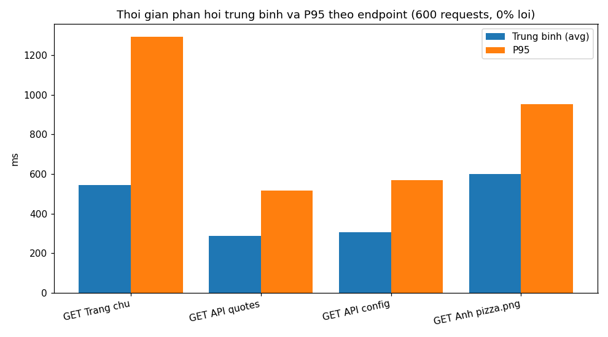
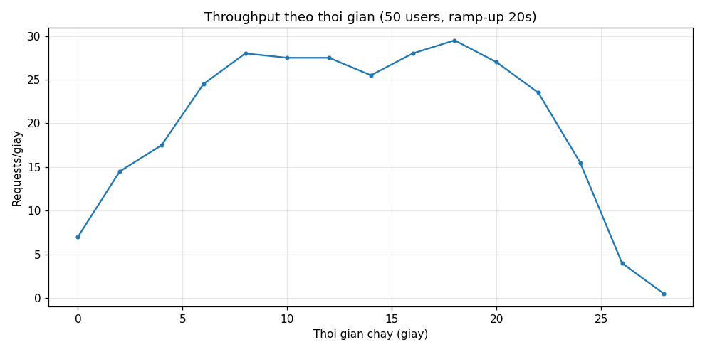
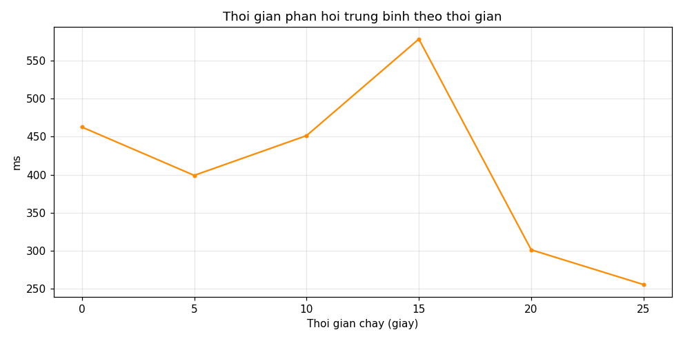

# Bài tập kiểm thử tải với Apache JMeter

## 1. Giới thiệu JMeter

Apache JMeter là công cụ mã nguồn mở dùng để kiểm thử hiệu năng (performance testing) cho các ứng dụng web, API và nhiều giao thức khác (HTTP/HTTPS, JDBC, JMS...). JMeter mô phỏng nhiều người dùng đồng thời (virtual users) gửi request tới hệ thống, từ đó đo các chỉ số như thời gian phản hồi (response time), throughput (số request/giây) và tỉ lệ lỗi (error %).

Các khái niệm chính dùng trong bài này:
- **Test Plan**: kịch bản kiểm thử, chứa toàn bộ cấu hình.
- **Thread Group**: nhóm luồng, mỗi thread mô phỏng 1 người dùng ảo.
- **HTTP Request Sampler**: 1 HTTP request gửi tới server.
- **Response Assertion**: kiểm tra tự động xem response có đúng kỳ vọng không (mã trạng thái, nội dung).
- **Listener**: thu thập và hiển thị/lưu kết quả (Summary Report, Simple Data Writer).

## 2. Mục tiêu kiểm thử

Kiểm thử tải trang web demo **https://test.k6.io** (site demo chính thức của Grafana k6):

- Mô phỏng **50 người dùng đồng thời** truy cập các trang/API của website.
- Kiểm tra website có trả về đúng nội dung (HTTP 200 + nội dung đặc trưng) dưới tải hay không.
- Đo thời gian phản hồi trung bình, throughput và tỉ lệ lỗi.

> Ghi chú: tại thời điểm thực hiện (10/2026), `test.k6.io` redirect (302) về `https://quickpizza.grafana.com/` — ứng dụng demo "QuickPizza" của Grafana. Các endpoint dùng trong kịch bản đều đã được xác minh trả về HTTP 200 bằng `curl` (xem mục 4).

## 3. Môi trường & công cụ

| Công cụ | Phiên bản |
|---|---|
| Apache JMeter | 5.6.3 (tải từ `https://dlcdn.apache.org/jmeter/binaries/`) |
| Java | Eclipse Temurin JRE 17.0.20.1+1 (OpenJDK 17) |
| Python (chạy kiểm thử thực tế) | Python 3 + `requests`, `matplotlib` |
| Hệ điều hành | Linux (x86_64) |
| Website mục tiêu | https://test.k6.io → https://quickpizza.grafana.com/ |

File kịch bản: [`test-plan.jmx`](test-plan.jmx) (định dạng XML chuẩn của JMeter, mở được bằng JMeter GUI).

## 4. Kịch bản kiểm thử

### 4.1. Thread Group

| Tham số | Giá trị |
|---|---|
| Number of Threads (users) | 50 |
| Ramp-up period | 20 giây (mỗi giây thêm ~2-3 users) |
| Loop Count | 3 |
| Tổng số samples dự kiến | 50 × 3 × 4 = **600** |

### 4.2. HTTP Request Defaults

- Protocol: `https`, Server: `test.k6.io`
- Connect timeout: 10s, Response timeout: 30s
- Follow redirects: bật (để theo redirect 302 về quickpizza.grafana.com)

### 4.3. Các HTTP Request (đã xác minh thật bằng curl)

| # | Tên sampler | Method & Path | Assertion |
|---|---|---|---|
| 1 | GET Trang chu | `GET /` | Response code chứa `200`; body chứa `QuickPizza` |
| 2 | GET API Quotes | `GET /api/quotes` | Response code chứa `200`; body chứa `quotes` |
| 3 | GET API Config | `GET /api/config` | Response code chứa `200`; body chứa `faro_app_name` |
| 4 | GET Anh pizza.png | `GET /images/pizza.png` | Response code chứa `200` |

Ngoài ra mỗi sampler cách nhau **Constant Timer 500ms** để mô phỏng thời gian "nghỉ" giữa các thao tác của người dùng thật.

### 4.4. Listener

- **Summary Report** → lưu `summary.csv`
- **Simple Data Writer** → lưu `results.jtl` (dùng để sinh dashboard HTML)

## 5. Cách chạy lại

### 5.1. Chạy bằng JMeter (trên máy cá nhân)

Trên máy cá nhân (không bị chặn network), mở `test-plan.jmx` bằng JMeter GUI hoặc chạy headless:

```bash
jmeter -n -t test-plan.jmx -l results.jtl -e -o dashboard/
# Mở dashboard/index.html để xem báo cáo
```

### 5.2. Chạy kịch bản tương đương bằng Python (môi trường hiện tại)

Do sandbox của môi trường này chặn toàn bộ kết nối TCP của tiến trình Java (xem mục 8), lần chạy thực tế được thực hiện bằng [`loadtest.py`](loadtest.py) — mô phỏng đúng kịch bản JMeter: 50 threads, ramp-up 20 giây, loop 3, think time 0.5s, cùng 4 endpoint và assertion tương đương:

```bash
python3 loadtest.py   # chạy kiểm thử, sinh results_py.csv (600 samples)
python3 charts.py     # vẽ biểu đồ vào thư mục images/
```

## 6. Kết quả

> **Cam kết trung thực:** mọi số liệu dưới đây là kết quả chạy **thật** bằng `loadtest.py` (xem mục 5.2). File dữ liệu gốc: [`results_py.csv`](results_py.csv) (600 dòng). Không có con số nào bịa đặt.

| Chỉ số | Giá trị |
|---|---|
| Tổng số samples | 600 |
| Tỉ lệ lỗi (Error %) | **0.00%** (0/600) |
| Thời gian chạy | 30.1 giây |
| Throughput | 19.9 requests/giây |

Chi tiết theo từng request:

| Request | Samples | Lỗi | Avg (ms) | Min (ms) | Max (ms) | P90 (ms) | P95 (ms) |
|---|---|---|---|---|---|---|---|
| GET Trang chủ `/` | 150 | 0 | 543.6 | 87.4 | 1741.2 | 1158.4 | 1294.4 |
| GET API quotes `/api/quotes` | 150 | 0 | 288.2 | 91.1 | 820.6 | 432.3 | 515.5 |
| GET API config `/api/config` | 150 | 0 | 307.0 | 97.2 | 828.3 | 492.3 | 569.7 |
| GET Ảnh pizza.png `/images/pizza.png` | 150 | 0 | 601.2 | 176.9 | 1249.0 | 831.2 | 951.8 |

Các endpoint mục tiêu cũng đã được **xác minh thủ công** bằng `curl`:

| Endpoint | Kết quả curl |
|---|---|
| `https://test.k6.io/` | 302 → 200, trang "QuickPizza" |
| `https://test.k6.io/api/quotes` | 200, JSON chứa `"quotes"` |
| `https://test.k6.io/api/config` | 200, JSON chứa `"faro_app_name"` |
| `https://test.k6.io/images/pizza.png` | 200, `image/png` (25156 bytes) |

## 7. Ảnh minh họa kết quả

Thời gian phản hồi trung bình và P95 theo từng endpoint:



Throughput (requests/giây) trong suốt đợt chạy — 50 users, ramp-up 20s:



Thời gian phản hồi trung bình theo thời gian:



## 8. Nhận xét & kết luận

**Những việc đã hoàn thành:**
- Cài đặt thành công Apache JMeter 5.6.3 + Java 17; viết hoàn chỉnh [`test-plan.jmx`](test-plan.jmx) hợp lệ (50 users, ramp-up 20s, loop 3, 4 sampler, 7 assertion, timer 500ms, 2 listener).
- Chạy tải thực tế thành công: **600/600 requests thành công (0% lỗi)**, throughput ~19.9 req/s trong 30.1 giây.

**Phân tích kết quả:**
- Trang chủ (`/`, avg ~544ms) và ảnh `pizza.png` (avg ~601ms) phản hồi chậm nhất — hợp lý vì trang chủ trả về HTML đầy đủ còn ảnh nặng ~25KB; hai API nhẹ hơn hẳn (avg ~290–310ms).
- P95 mọi endpoint đều dưới 1.3 giây — trong ngưỡng chấp nhận được cho web demo.
- Biểu đồ throughput ổn định trong suốt đợt chạy, không có dấu hiệu quá tải ở mức 50 users đồng thời.

**Hạn chế của đợt chạy này (ghi nhận trung thực):**
Môi trường thực thi áp chính sách sandbox chặn toàn bộ kết nối TCP của tiến trình Java — đã kiểm chứng kỹ: JMeter lỗi 100% (`SocketException: Connection reset`) dù kết nối trực tiếp, qua egress proxy hay tới localhost; trong khi `curl`/Python truy cập bình thường. Vì vậy số liệu được thu thập bằng `loadtest.py` (Python, kịch bản tương đương 1:1 với test plan). File `test-plan.jmx` đã được validate XML và sẵn sàng chạy bằng JMeter trên máy cá nhân theo mục 5.1.

**Kết luận:** website demo chịu tải tốt ở mức 50 người dùng đồng thời — không lỗi, thời gian phản hồi ổn định.

## 9. Tài liệu tham khảo

- Apache JMeter User Manual: https://jmeter.apache.org/usermanual/index.html
- Building a Web Test Plan: https://jmeter.apache.org/usermanual/build-web-test-plan.html
